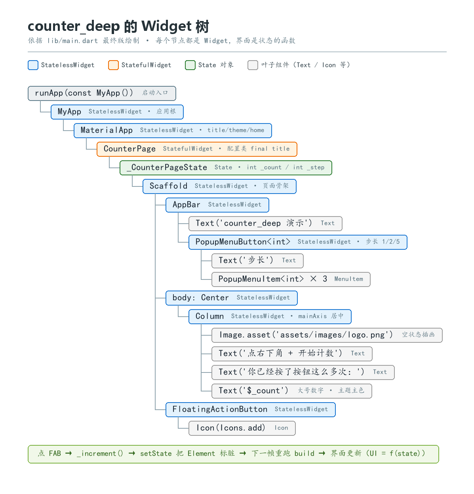

# counter_deep Widget 树手绘图（文字版）



> 说明：课堂要求用纸或绘图工具手绘，本文件是手绘底稿（文字树），对照下方层级与
> Stateless/Stateful 标注誊抄即可。树对应改造完成后的最终版 main.dart。

## 完整层级

```
runApp(const MyApp())                       ← 启动链路：main 挂载根 Widget
│
MyApp                                       〔StatelessWidget · 应用根〕
└── MaterialApp                             〔StatelessWidget · 应用级配置 title/theme/home〕
    └── CounterPage                         〔StatefulWidget · home 页面（配置类，final title）〕
        └─(State: _CounterPageState)        ← 可变状态住在这里：int _count = 0; int _step = 1;
            └── Scaffold                    〔StatelessWidget · 页面骨架〕
                ├── AppBar                  〔StatelessWidget〕
                │   ├── Text('counter_deep 演示')
                │   └── PopupMenuButton<int> 〔StatelessWidget · 步长选择器（AppBar.actions）〕
                │       ├── Text('步长 $_step')
                │       └── PopupMenuItem<int> ×3（1 / 2 / 5，弹层）
                ├── body: Center            〔StatelessWidget · 单子级居中〕
                │   └── Column              〔StatelessWidget · 纵向排列，mainAxis 居中〕
                │       ├── [_count == 0 时] Image.asset('assets/images/logo.png')
                │       │                    〔StatelessWidget · 空状态插画，资源管理验证点〕
                │       ├── [_count == 0 时] Text('点右下角 + 开始计数')
                │       ├── Text('你已经按了按钮这么多次：')
                │       └── Text('$_count')  〔大号数字，颜色 Theme.of(context).colorScheme.primary〕
                └── FloatingActionButton    〔StatelessWidget〕
                    └── Icon(Icons.add)
```

## 两类 Widget 标注

| Widget | 类型 | 理由 |
| --- | --- | --- |
| MyApp / MaterialApp | StatelessWidget | 纯配置渲染，无内部可变状态 |
| CounterPage | **StatefulWidget** | 持有 State，_count/_step 由用户交互推动变化 |
| Scaffold / AppBar / Center / Column / Text / Icon / Image.asset / FAB / PopupMenuButton | StatelessWidget | build 只根据入参渲染 |

## 数据流（口头检查点：点 FAB 后发生了什么）

```
用户点 FAB
→ FloatingActionButton.onPressed 调用 _increment()
→ setState(() { _count += _step; })
→ State 标记对应 Element 为 dirty
→ 下一帧 Flutter 框架重新调用 build()
→ 新 Widget 配置替换旧树 → 渲染更新，界面显示新计数
```

注意：只有 CounterPage 一个 Stateful 节点，重建范围是它以下的子树；
Scaffold 等子 Widget 由 build 重新生成配置，Element/RenderObject 尽量复用。
